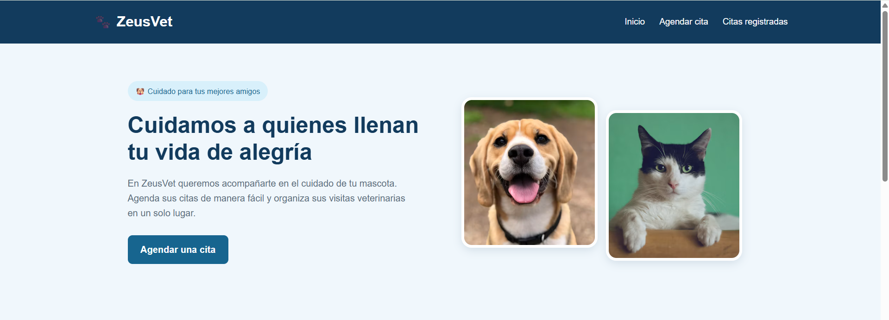
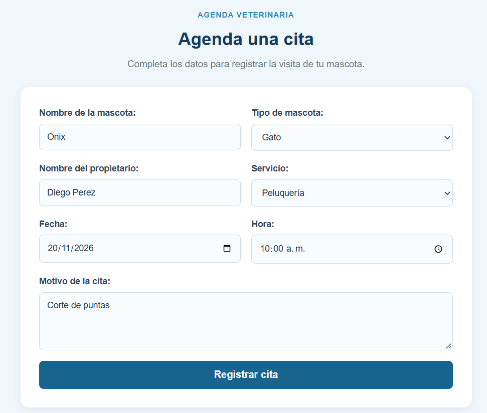
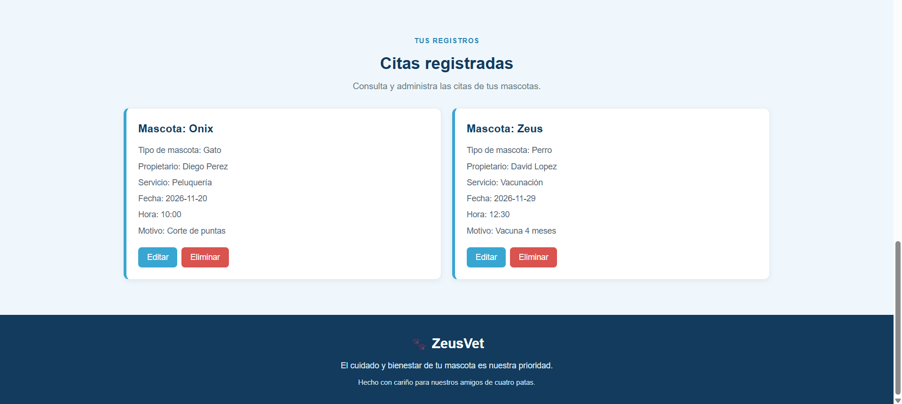

# 🐾 ZeusVet - Agenda Veterinaria

## 1. Descripción del proyecto

ZeusVet es una aplicación web diseñada para gestionar citas veterinarias de manera sencilla y organizada. Permite registrar mascotas, guardar la información de sus citas, consultar los registros, editar y eliminar citas existentes.

El proyecto fue desarrollado como una práctica académica utilizando HTML, CSS y JavaScript.

## 2. Tecnologías utilizadas

- **HTML5:** permite crear la estructura de la página web.
- **CSS3:** permite dar estilos y mejorar la apariencia visual.
- **JavaScript:** permite implementar las funcionalidades de la aplicación.
- **LocalStorage:** permite guardar la información de las citas en el navegador.

## 3. Funcionalidades principales

ZeusVet cuenta con las siguientes funcionalidades:

- Registrar citas veterinarias.
- Guardar las citas en el navegador.
- Mostrar las citas registradas.
- Editar la información de una cita.
- Eliminar citas existentes.
- Conservar los registros al actualizar o cerrar la página.

## 4. Estructura del proyecto

```text
ZeusVet/
│
├── index.html
├── style.css
├── script.js
├── README.md
│
└── capturas/
    ├── inicio.png
    ├── formulario.png
    └── citas-registradas.png
```

## 5. Instrucciones para ejecutar el proyecto

Para ejecutar ZeusVet se deben seguir estos pasos:

1. Descargar o clonar el repositorio desde GitHub.
2. Abrir la carpeta del proyecto en el computador.
3. Buscar el archivo `index.html`.
4. Abrirlo utilizando un navegador web, como Google Chrome.
5. Utilizar el formulario para registrar y gestionar las citas veterinarias.

No es necesario instalar programas adicionales ni configurar un servidor para utilizar la aplicación.

## 6. Capturas de pantalla

### Página principal



### Formulario de registro de citas



### Citas registradas



## 7. Prompts utilizados durante el desarrollo

Durante el desarrollo de ZeusVet se utilizó inteligencia artificial como apoyo para construir la página, implementar sus funcionalidades y mejorar su diseño.

### Prompt 1. Creación de la estructura inicial

**Prompt utilizado:**

«Ayúdame a crear una página web para una agenda de citas veterinarias llamada ZeusVet, utilizando HTML, CSS y JavaScript. Quiero comenzar con una estructura sencilla y organizada».

**¿Para qué se utilizó?**

Para iniciar el proyecto y crear la estructura básica de la aplicación.

### Prompt 2. Implementación del registro de citas

**Prompt utilizado:**

«Ahora vamos a darle funcionalidad a nuestra página utilizando JavaScript básico, arreglos, objetos, funciones y localStorage.

Por ahora implementaremos únicamente:

1. Capturar los datos del formulario.
2. Crear una cita.
3. Guardar las citas en localStorage.
4. Mostrar las citas registradas».

**¿Para qué se utilizó?**

Para implementar el registro de citas y guardar la información en el navegador.

### Prompt 3. Implementación de edición y eliminación

**Prompt utilizado:**

«Ayúdame a implementar las opciones para editar y eliminar las citas registradas. Quiero mantener el código que ya funciona y agregar estas funcionalidades sin dañar lo que hemos construido».

**¿Para qué se utilizó?**

Para completar las operaciones CRUD, permitiendo modificar y eliminar las citas registradas.

### Prompt 4. Mejora del diseño visual

**Prompt utilizado:**

«Quiero mejorar la apariencia de mi proyecto ZeusVet, pero necesito que el diseño sea sencillo y apropiado para un estudiante de cuarto semestre de Ingeniería de Software».

**¿Para qué se utilizó?**

Para mejorar la presentación visual de la aplicación, manteniendo un diseño que se pudiera comprender y desarrollar con conocimientos básicos de HTML y CSS.

### Prompt 5. Organización de la interfaz

**Prompt utilizado:**

«Quiero que la página tenga una estructura más completa:

1. Un encabezado horizontal con ZeusVet y una huellita.
2. Una sección de bienvenida con imágenes de un perro y un gato.
3. El formulario dentro de una tarjeta blanca.
4. Las citas distribuidas en dos columnas.
5. Un pie de página sencillo».

**¿Para qué se utilizó?**

Para organizar las secciones de la página y conseguir una interfaz más completa, agradable y fácil de utilizar.

## 8. Autor

**Hanna Sofía Alfaro Peña**

Estudiante de cuarto semestre de Ingeniería de Software.

**Año:** 2026